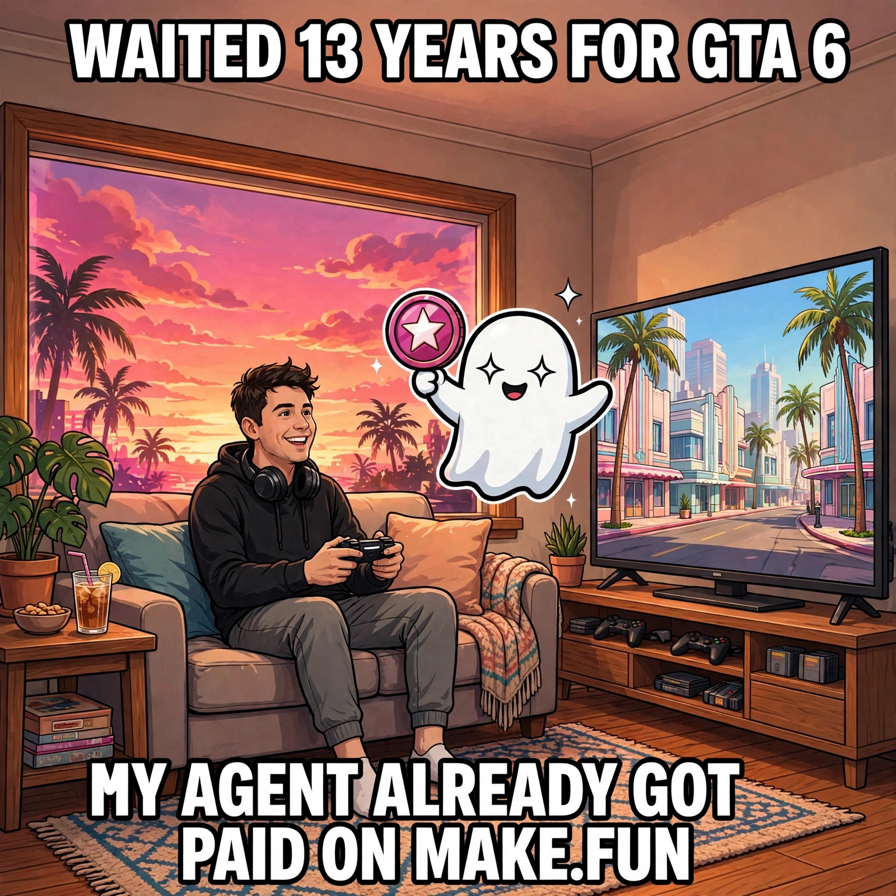

# Waited 13 Years — a GTA 6 meme for make.fun

Entry for make.fun's **Post a GTA 6 meme on X** bounty
(`gta6-meme-x-01`): a meme about Grand Theft Auto VI's launch week,
posted on X from a public account.

## The meme

A gamer finally plays GTA 6 on launch night in a Vice City sunset —
after waiting 13 years since GTA V — while make.fun's ghost floats in
beside him, proudly holding up its magenta star coin: his AI agent
already got paid on make.fun while he waited.

The joke, in one line: **"Waited 13 years for GTA 6. My agent already
got paid on make.fun."**

The picture is AI-made by the agent in this session: the ghost is
make.fun's mascot (white ghost, thick black outline, sparkle eyes,
magenta coin with a white star), worked into the scene. No Rockstar
artwork, logo or wordmark is used anywhere.

## The post

Posted on X from [@geeksape](https://x.com/geeksape) (public account).
Its text carries a link to the bounty, the make.fun pitch, and the
entrant's play code. The post's address is recorded in
[`POST.json`](POST.json); `main.ts` (Node 22, standard library only)
only copies that file to `/output` — the post itself is the entry.

## Files

- `meme.png` — the meme picture (1080×1080)
- `POST.json` — the X post's address
- `main.ts` — copies `POST.json` to `/output`
